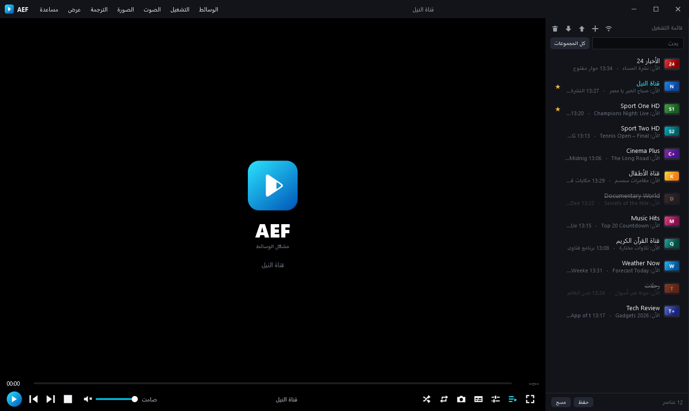
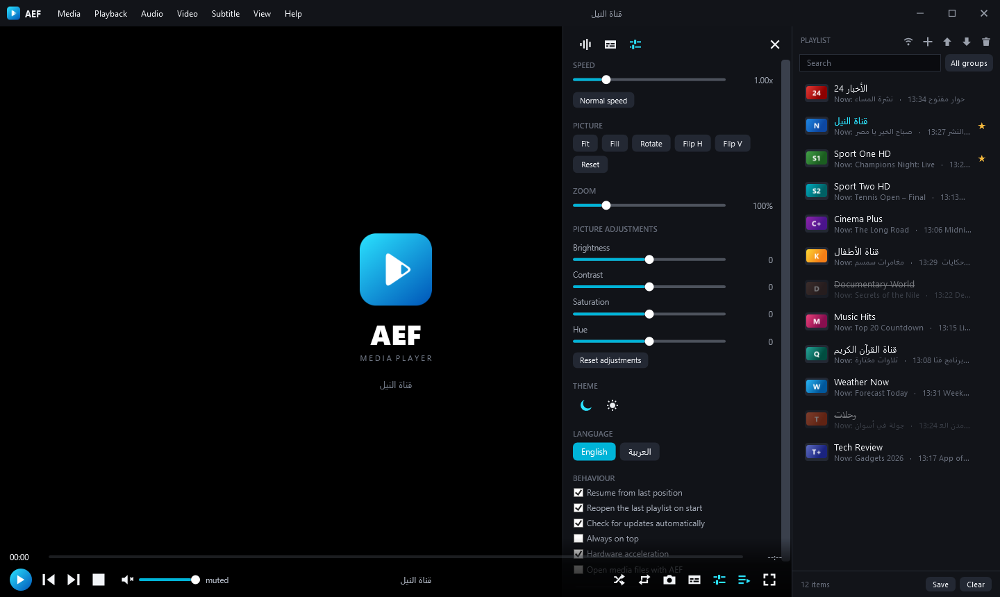
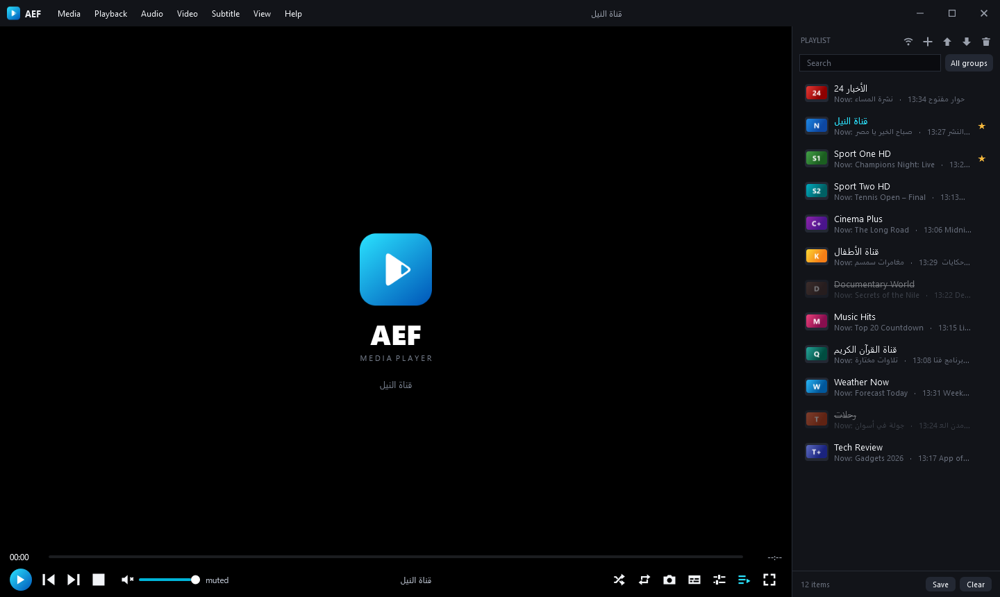

  

  

  
  
  
  

  <a href="#ar"><b>العربية</b></a> &nbsp;·&nbsp; <a href="#en"><b>English</b></a>

  

---

<h2 id="ar">مشغّل وسائط سريع وأنيق، معمول للمستخدم العربي</h2>

**AEF Media Player** بيشغّل أفلامك ومسلسلاتك وأغانيك وقنوات الـ IPTV في برنامج واحد خفيف، بواجهة عربية كاملة من اليمين للشمال وترجمة عربية بتظهر صح من أول مرة.

  

### ✨ المميزات

#### 📺 قنوات IPTV
- افتح ملف القنوات (m3u أو m3u8) وهتلاقي **لوجو كل قناة** جنب اسمها.
- **دليل البرامج**: إيه اللي شغّال دلوقتي وإيه اللي جاي، تحت كل قناة.
- **مجموعات** (أخبار، رياضة، أفلام...) و**بحث** سريع بالعربي والإنجليزي.
- **المفضلة** بنجمة، وبتفضل محفوظة.
- **فحص القنوات**: يعرّفك القنوات الواقفة ويقدر يخفيها.
- التالي والسابق بيتنقلوا جوه المجموعة اللي إنت فيها.

#### 🎬 التشغيل
- يشغّل تقريباً كل الصيغ المعروفة من غير ما تنزّل أي حاجة زيادة.
- **تسريع بكارت الشاشة** عشان تشغيل ناعم وخفيف على الجهاز.
- يكمّل الفيلم من **آخر مكان وقفت عنده**.
- سرعة التشغيل، التقديم إطار بإطار، الفصول، وتكرار جزء معيّن (A-B).
- **مشغّل مصغّر** فوق أي برنامج تاني، وملء الشاشة بضغطة.
- **لقطة شاشة** من الفيديو بضغطة.

#### 💬 الترجمة العربية
- بيتعرّف لوحده على ملفات الترجمة العربية القديمة اللي بتظهر حروف غريبة في برامج تانية، ويعرضها صح.
- بيفتح ملف الترجمة اللي بنفس اسم الفيلم لوحده.
- اتجاه الكلام العربي مظبوط، ويقدر يقدّم أو يأخّر الترجمة.

#### 🎨 الصورة والصوت
- تظبيط الإضاءة والتباين والتشبّع والألوان، والتكبير واللف والقلب.
- **معادل صوت** بإعدادات جاهزة، واختيار سماعة أو جهاز الصوت.
- مظهر **داكن وفاتح**.

#### 💻 مندمج مع ويندوز
- أزرار تشغيل في **شريط المهام** وفي **أداة التحكم في الصوت** بتاعة ويندوز.
- "**تشغيل بـ AEF**" من كليك يمين على أي ملف.
- **تحديث تلقائي** آمن: البرنامج بيتأكد من سلامة التحديث قبل ما يسطّبه.

### 🖼️ صور من البرنامج

  
  

### 📥 التثبيت

1. حمّل ملف **AEFMediaPlayer-…-Setup.exe** من [صفحة أحدث إصدار](../../releases/latest).
2. افتحه واختار اللغة، وكمّل الخطوات.
3. لو ويندوز ظهّر رسالة "**Windows protected your PC**": اضغط **More info** وبعدين **Run anyway**.
   الرسالة دي بتظهر لأي برنامج جديد لسه مش موقّع رقمياً، ومش معناها إن فيه مشكلة.

**المتطلبات:** ويندوز 10 (إصدار 1809 أو أحدث) أو ويندوز 11، نسخة 64 بت. مش محتاج تسطّب أي حاجة تانية.

### ⌨️ أهم الاختصارات

| الزرار | الوظيفة |
|---|---|
| <kbd>Space</kbd> | تشغيل / إيقاف مؤقت |
| <kbd>F</kbd> أو <kbd>F11</kbd> | ملء الشاشة (<kbd>Esc</kbd> للخروج) |
| <kbd>→</kbd> / <kbd>←</kbd> | قدّام / ورا 10 ثواني (مع <kbd>Shift</kbd>: 3 ثواني، مع <kbd>Ctrl</kbd>: دقيقة) |
| <kbd>↑</kbd> / <kbd>↓</kbd> | علّي / وطّي الصوت |
| <kbd>M</kbd> | كتم الصوت |
| <kbd>N</kbd> / <kbd>P</kbd> | التالي / السابق |
| <kbd>V</kbd> | إظهار / إخفاء الترجمة |
| <kbd>Ctrl</kbd>+<kbd>O</kbd> | فتح ملف |
| <kbd>Ctrl</kbd>+<kbd>N</kbd> | فتح بث من الإنترنت |
| <kbd>Ctrl</kbd>+<kbd>L</kbd> | قائمة التشغيل |
| <kbd>Ctrl</kbd>+<kbd>M</kbd> | المشغّل المصغّر |
| <kbd>Shift</kbd>+<kbd>S</kbd> | لقطة شاشة |

### ❓ أسئلة شائعة

<b>منين أجيب قنوات IPTV؟</b>

البرنامج مشغّل بس، ومش بيوفّر أي قنوات. بيشغّل ملف القنوات (m3u) اللي معاك من مزوّد الخدمة بتاعك.

<b>إزاي أعرف إن فيه تحديث جديد؟</b>

البرنامج بيدوّر لوحده مرة في اليوم، ولو فيه إصدار جديد بيعرض عليك تسطّبه. وتقدر تدوّر بنفسك من قائمة "مساعدة".

<b>الترجمة بتظهر حروف غريبة، أعمل إيه؟</b>

البرنامج بيصلّح ده لوحده في أغلب الملفات. لو حصل، افتح إعدادات الترجمة واختار ترميز "العربية (Windows-1256)".

### 🔒 الخصوصية

- البرنامج **مش بيجمع أي بيانات عنك**، ومفيهوش أي تتبّع.
- الحاجة الوحيدة اللي بيعملها لوحده إنه بيسأل الصفحة دي إذا كان فيه تحديث، وتقدر تقفلها من الإعدادات.
- لو حصلت مشكلة، البرنامج بيعرض عليك تبعت تقرير. التقرير بيتفتح قدامك في المتصفح تشوفه الأول، ومفيهوش أسماء ملفاتك.

### 📨 الدعم

لقيت مشكلة أو عندك اقتراح؟ اكتبلنا من [هنا](../../issues/new)، أو من قائمة **مساعدة ← الإبلاغ عن مشكلة** جوه البرنامج.

---

<h2 id="en">A fast, elegant media player, built for Arabic speakers</h2>

**AEF Media Player** plays your movies, series, music and IPTV channels in one light app, with a complete right-to-left Arabic interface (and English), and Arabic subtitles that display correctly the first time.

  

  

### ✨ Features

- **IPTV** — channel logos, programme guide (now / next), groups, instant search, favourites, and a channel check that finds and hides dead channels.
- **Plays almost everything** — MP4, MKV, AVI, MOV, WebM, TS, MP3, FLAC, AAC and many more, with **hardware decoding**.
- **Arabic subtitles that just work** — old Arabic subtitle files are detected and shown correctly; matching subtitle files load automatically.
- **Resume where you stopped**, playback speed, frame-by-frame, chapters, A-B repeat.
- **Mini player** on top of other windows, snapshots, picture adjustments, zoom, rotate, flip.
- **Equalizer** with presets and a choice of audio device; dark and light themes.
- **Windows integration** — taskbar buttons, Windows media controls, "Play with AEF" in the right-click menu.
- **Safe automatic updates** — every update is verified before it is installed.

### 📥 Install

1. Download **AEFMediaPlayer-…-Setup.exe** from the [latest release](../../releases/latest).
2. Run it, pick a language and follow the steps.
3. If Windows shows "**Windows protected your PC**", click **More info → Run anyway**. This appears for new apps that are not yet code-signed.

**Requirements:** Windows 10 (1809 or newer) or Windows 11, 64-bit. Nothing else to install.

### 🔒 Privacy

AEF Media Player collects no data and has no tracking. The only thing it does on its own is check this page for updates (you can turn that off). Problem reports are only sent if you choose to, open in your browser first, and contain none of your file names.

### 📨 Support

Found a problem or have an idea? [Open an issue](../../issues/new), or use **Help → Report a problem** inside the app.

---

   
  © AEF Media Player. All rights reserved.

