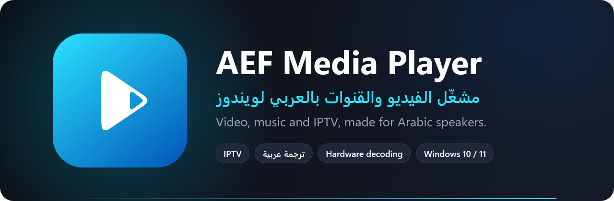
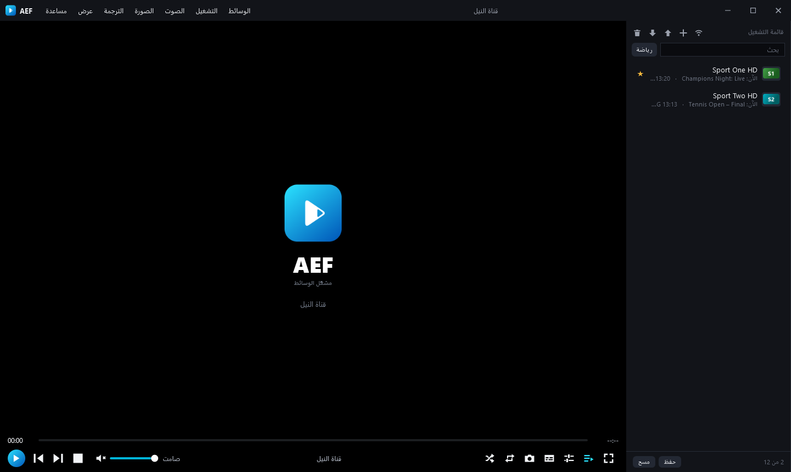

  

  

  
  
  
  

  <a href="https://merofarahat923-coder.github.io/aef-media-player-releases/"><b>🌐 الموقع</b></a> &nbsp;·&nbsp;
  <a href="https://merofarahat923-coder.github.io/aef-media-player-releases/help.html"><b>📖 المساعدة</b></a> &nbsp;·&nbsp;
  <a href="#ar"><b>العربية</b></a> &nbsp;·&nbsp; <a href="#en"><b>English</b></a>

  

---

<h2 id="ar">مشغّل وسائط سريع وأنيق، معمول للمستخدم العربي</h2>

**AEF Media Player** بيشغّل أفلامك ومسلسلاتك وأغانيك وقنوات الـ IPTV في برنامج واحد خفيف، بواجهة عربية كاملة من اليمين للشمال وترجمة عربية بتظهر صح من أول مرة.

  

### ✨ المميزات

#### 📺 IPTV زي الرسيفر
- **وضع التليفزيون:** أول ما تشغّل قناة، البرنامج يبقى رسيفر: شريط القناة (الرقم واللوجو والاسم، والبرنامج اللي شغال واللي جاي)، والأسهم تقلّب القنوات، و<kbd>Enter</kbd> يفتح قائمة القنوات فوق الصورة.
- **قائمة قنوات احترافية:** المجموعات، والقنوات بلوجوهاتها وأرقامها، وجدول برامج القناة اللي واقف عليها، وبحث سريع بالعربي والإنجليزي.
- **حسابات IPTV** (اسم مستخدم وكلمة سر) أو **رابط قائمة قنوات (m3u)**: القنوات والأفلام والمسلسلات بتيجي لوحدها.
- **شاشة رئيسية للـ IPTV** (<kbd>Ctrl</kbd>+<kbd>T</kbd>): البث المباشر والأفلام والمسلسلات، وحالة اشتراكك وميعاد انتهاؤه، و"كمّل المشاهدة"، وآخر القنوات اللي اتفرجت عليها.
- **دليل برامج كامل** (<kbd>Ctrl</kbd>+<kbd>G</kbd>) مع تذكير قبل البرنامج، و**شوف اللي فاتك** أو ابدأ البرنامج من أوله.
- **تسجيل البث** بضغطة (<kbd>Ctrl</kbd>+<kbd>R</kbd>) أو بميعاد من دليل البرامج.
- **قناتين أو أربعة مع بعض** على نفس الشاشة (<kbd>Ctrl</kbd>+<kbd>U</kbd>).
- **قفل القنوات أو مجموعات كاملة برقم سري**، واكتب رقم القناة على طول زي الريموت.
- **الأفلام والمسلسلات بصورها** وقصتها وتقييمها، ومفضلة ليها، وبتكمّل من المكان اللي وقفت عنده.
- **المفضلة** و**فحص القنوات** اللي بيعرّفك القنوات الواقفة ويخفيها.

#### 📱 ريموت من الموبايل
- امسح الكود بكاميرا الموبايل (<kbd>Ctrl</kbd>+<kbd>J</kbd>) وتحكّم في البرنامج بريموت شكله زي الحقيقي: الأسهم وOK، والصوت والقنوات، والأرقام، وقائمة القنوات.
- مش محتاج تنزّل أي تطبيق، وتقدر **تثبّته على موبايلك كأيقونة**.
- شغال على شبكة البيت بس، ومحدش يقدر يستخدمه من غير الكود.

#### 🎬 التشغيل
- يشغّل تقريباً كل الصيغ المعروفة من غير ما تنزّل أي حاجة زيادة، مع **تسريع بكارت الشاشة**.
- يكمّل الفيلم من **آخر مكان وقفت عنده**، وصورة صغيرة من الفيديو على شريط الوقت.
- سرعة التشغيل، والتقديم إطار بإطار، والفصول، وتكرار جزء معيّن (A-B)، و**علامات** (<kbd>B</kbd>) و**مؤقت نوم**.
- **مكتبة** لأفلامك ومسلسلاتك بصورها (<kbd>Ctrl</kbd>+<kbd>E</kbd>).
- **التشغيل على التليفزيون الذكي** أو عرض الشاشة كلها (<kbd>Ctrl</kbd>+<kbd>K</kbd>).
- **مشغّل مصغّر** فوق أي برنامج تاني، و**لقطة شاشة** بضغطة.

#### 💬 الترجمة العربية
- بيتعرّف لوحده على ملفات الترجمة العربية القديمة اللي بتظهر حروف غريبة في برامج تانية، ويعرضها صح.
- بيفتح ملف الترجمة اللي بنفس اسم الفيلم لوحده، و**يدوّر على ترجمة من الإنترنت** بضغطة (<kbd>Ctrl</kbd>+<kbd>D</kbd>).
- اتجاه الكلام العربي مظبوط، ويقدر يقدّم أو يأخّر الترجمة.

#### 🎨 الشكل واللغة
- **5 لغات للواجهة:** العربية، والإنجليزية، والفرنسية، والتركية، والأردو.
- **4 أشكال** (داكن، فاتح، أسود تماماً، رمادي أزرق) و**8 ألوان** تختار منها.
- **سهولة الاستخدام:** خط أكبر، وتباين عالٍ، وأسماء مسموعة للأزرار مع قارئ الشاشة.
- تظبيط الإضاءة والتباين والألوان، و**معادل صوت** بإعدادات جاهزة.

#### 💻 مندمج مع ويندوز
- أزرار تشغيل في **شريط المهام** وفي **أداة التحكم في الصوت** بتاعة ويندوز.
- "**تشغيل بـ AEF**" من كليك يمين على أي ملف.
- **تحديث تلقائي آمن:** التحديث بينزل في الخلفية، والبرنامج بيتأكد من سلامته، وبيتثبّت لما تقفل البرنامج.

### 🖼️ صور من البرنامج

  
  

### 📥 التثبيت

1. حمّل ملف **AEFMediaPlayer-…-Setup.exe** من [صفحة أحدث إصدار](../../releases/latest).
2. افتحه واختار اللغة، وكمّل الخطوات.
3. لو ويندوز ظهّر رسالة "**Windows protected your PC**": اضغط **More info** وبعدين **Run anyway**.
   الرسالة دي بتظهر لأي برنامج جديد لسه مش موقّع رقمياً، ومش معناها إن فيه مشكلة.

**المتطلبات:** ويندوز 10 (إصدار 1809 أو أحدث) أو ويندوز 11، نسخة 64 بت. مش محتاج تسطّب أي حاجة تانية.

### ⌨️ أهم الاختصارات

| الزرار | الوظيفة |
|---|---|
| <kbd>Space</kbd> | تشغيل / إيقاف مؤقت |
| <kbd>F</kbd> أو <kbd>F11</kbd> | ملء الشاشة (<kbd>Esc</kbd> للخروج) |
| <kbd>→</kbd> / <kbd>←</kbd> | قدّام / ورا 10 ثواني (مع <kbd>Shift</kbd>: 3 ثواني، مع <kbd>Ctrl</kbd>: دقيقة) |
| <kbd>↑</kbd> / <kbd>↓</kbd> | علّي / وطّي الصوت |
| <kbd>M</kbd> | كتم الصوت |
| <kbd>N</kbd> / <kbd>P</kbd> | التالي / السابق |
| <kbd>V</kbd> | إظهار / إخفاء الترجمة |
| <kbd>Ctrl</kbd>+<kbd>O</kbd> | فتح ملف |
| <kbd>Ctrl</kbd>+<kbd>N</kbd> | فتح بث من الإنترنت |
| <kbd>Ctrl</kbd>+<kbd>L</kbd> | قائمة التشغيل |
| <kbd>Ctrl</kbd>+<kbd>M</kbd> | المشغّل المصغّر |
| <kbd>Shift</kbd>+<kbd>S</kbd> | لقطة شاشة |
| <kbd>Ctrl</kbd>+<kbd>T</kbd> | الشاشة الرئيسية للـ IPTV |
| <kbd>T</kbd> | وضع التليفزيون (دخول / خروج) |
| <kbd>↑</kbd> / <kbd>↓</kbd> في وضع التليفزيون | القناة التالية / السابقة |
| <kbd>Enter</kbd> في وضع التليفزيون | قائمة القنوات |
| <kbd>I</kbd> | معلومات القناة |
| <kbd>Ctrl</kbd>+<kbd>G</kbd> | دليل البرامج |
| <kbd>Ctrl</kbd>+<kbd>J</kbd> | ريموت الموبايل |
| <kbd>Ctrl</kbd>+<kbd>,</kbd> | الإعدادات |

### ❓ أسئلة شائعة

<b>منين أجيب قنوات IPTV؟</b>

البرنامج مشغّل بس، ومش بيوفّر أي قنوات. بيشغّل حساب IPTV أو ملف/رابط القنوات (m3u) اللي معاك من مزوّد الخدمة بتاعك.

<b>إزاي أعرف إن فيه تحديث جديد؟</b>

البرنامج بيدوّر لوحده مرة في اليوم، ولو فيه إصدار جديد بينزّله في الخلفية ويسطّبه لما تقفل البرنامج. ولو حابب يسألك الأول، اقفل "تسطيب التحديثات لوحدها" من الإعدادات. وتقدر تدوّر بنفسك من قائمة "مساعدة".

<b>إزاي أستخدم الموبايل كريموت؟</b>

دوس <kbd>Ctrl</kbd>+<kbd>J</kbd> في البرنامج، وامسح الكود اللي هيظهر بكاميرا الموبايل. لازم الموبايل والكمبيوتر يكونوا على نفس الواي فاي. ومن صفحة الريموت تقدر تثبّته كأيقونة على موبايلك.

<b>الترجمة بتظهر حروف غريبة، أعمل إيه؟</b>

البرنامج بيصلّح ده لوحده في أغلب الملفات. لو حصل، افتح إعدادات الترجمة واختار ترميز "العربية (Windows-1256)".

### 🔒 الخصوصية

- البرنامج **مش بيجمع أي بيانات عنك**، ومفيهوش أي تتبّع.
- الحاجة الوحيدة اللي بيعملها لوحده إنه بيسأل الصفحة دي إذا كان فيه تحديث (وينزّله لو فيه)، وتقدر تقفلها من الإعدادات.
- كلمات سر حسابات الـ IPTV بتتحفظ متشفّرة على جهازك، وبتتبعت لسيرفر المزوّد بتاعك بس.
- ريموت الموبايل بيشتغل بس لما إنت تفتحه، وعلى شبكة البيت بس، وبكود سري.
- لو حصلت مشكلة، البرنامج بيعرض عليك تبعت تقرير. التقرير بيتفتح قدامك في المتصفح تشوفه الأول، ومفيهوش أسماء ملفاتك.

### 📨 الدعم

لقيت مشكلة أو عندك اقتراح؟ اكتبلنا من [هنا](../../issues/new)، أو من قائمة **مساعدة ← الإبلاغ عن مشكلة** جوه البرنامج.

---

<h2 id="en">A fast, elegant media player, built for Arabic speakers</h2>

**AEF Media Player** plays your movies, series, music and IPTV channels in one light app, with a complete right-to-left Arabic interface (plus English, French, Turkish and Urdu), and Arabic subtitles that display correctly the first time.

  

  

### ✨ Features

- **IPTV like a TV receiver** — when a channel plays, the player becomes a receiver: a channel banner (number, logo, name, what is on and next), the arrow keys change channel, and <kbd>Enter</kbd> opens the channel list over the picture, with groups, logos and each channel's programme guide.
- **IPTV accounts or channel list links (m3u)** — channels, films and series come in by themselves; an **IPTV home screen** (<kbd>Ctrl</kbd>+<kbd>T</kbd>) shows your subscription's state, Continue watching and recent channels.
- **Programme guide** with reminders, **catch-up** (watch what you missed, or start from the beginning), **recording** (now or scheduled), **multi-view** (two or four channels at once), a **parental PIN** for channels or groups, and channel numbers.
- **Films and series** with posters, plots and ratings, favourites, and they continue where you stopped.
- **Phone remote** (<kbd>Ctrl</kbd>+<kbd>J</kbd>) — scan a code and drive the player with a remote that looks like a real one; no app to install, and it can be added to your phone's home screen. Home network only, protected by a secret code.
- **Plays almost everything** — MP4, MKV, AVI, MOV, WebM, TS, MP3, FLAC, AAC and many more, with **hardware decoding**.
- **Arabic subtitles that just work** — old Arabic subtitle files are detected and shown correctly; matching subtitle files load automatically, and subtitles can be found online with one key.
- **Resume where you stopped**, seek-bar preview, bookmarks, sleep timer, speed, frame-by-frame, chapters, A-B repeat, a **library** of your films and series, and **play on your smart TV**.
- **Five interface languages**, four looks and eight accent colours, and **accessibility**: larger text, high contrast, spoken button names for screen readers.
- **Windows integration** — taskbar buttons, Windows media controls, "Play with AEF" in the right-click menu.
- **Safe automatic updates** — downloaded in the background, verified, and installed when you close the player.

### 📥 Install

1. Download **AEFMediaPlayer-…-Setup.exe** from the [latest release](../../releases/latest).
2. Run it, pick a language and follow the steps.
3. If Windows shows "**Windows protected your PC**", click **More info → Run anyway**. This appears for new apps that are not yet code-signed.

**Requirements:** Windows 10 (1809 or newer) or Windows 11, 64-bit. Nothing else to install.

### 🔒 Privacy

AEF Media Player collects no data and has no tracking. The only thing it does on its own is check this page for updates and download them (you can turn that off). IPTV passwords are stored encrypted on your PC and sent only to your provider; the phone remote runs only when you open it, on your home network, behind a secret code. Problem reports are only sent if you choose to, open in your browser first, and contain none of your file names.

### 📨 Support

Found a problem or have an idea? [Open an issue](../../issues/new), or use **Help → Report a problem** inside the app.

---

   
  © AEF Media Player. All rights reserved.

